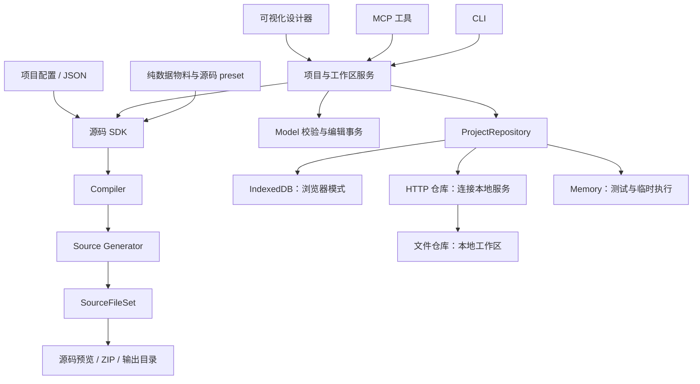

# ConfigForm：源码生成 SDK、本地工作区与 MCP 方案

日期：2026-10-14。状态：首个可用闭环已实现。Source 提供底层 `generateProjectSource`
和 `selectProjectSourceDocument`，Studio 提供两套纯数据 preset 与创作工具，Local 提供文件仓库、
HTTP 服务、CLI、设计器和官方 SDK 的 stdio MCP。下文保留产品目标与架构设计，具体用法及当前
限制以 [Studio](./studio/README.md) 和 [Local](./local/README.md) 为准。

2026-10-15 验收：SDK 打包后在仓库外安装，NodeNext 类型检查、公共入口、CLI、HTTP 和 MCP
验证通过；Element Plus 与 Ant Design Vue 导出工程均在独立目录全新安装、类型检查、构建，
并通过筛选、行点击弹窗、必填校验、关闭、图片和手机布局验证。工作台 681 项、运行时
146 项回归及 6 项本地工作区浏览器场景通过。个人模板共享、日志压缩和手改源码回导仍未实现。

## 产品目标

让开发者从需求快速得到可预览、可运行、可继续维护的 Vue 源码。配置是界面的创作模型，
设计器是可视化编辑入口，MCP 是 AI 编辑入口，源码是主要交付物。

用户路径应是：描述界面 → AI 选用物料与模板 → 创建或修改配置 → 在设计器中审核和调整
→ 生成源码 → 在普通 Vue 项目中继续开发。AI 和设计器操作同一份项目，复用同一套校验、
事务和生成器。

类似 Figma 的价值在于共享设计资产、预览和修改，而本产品的交付目标是实际 Vue 工程。
首版以表单、查询列表、详情、Dialog/Drawer 和本地演示交互为重点，不扩展为任意自由画布。
导出后的源码继续由开发者维护；首版不承诺将手改源码无损回导设计器。

## 当前实现与后续重点

| 能力             | 当前实现                                                             | 后续重点                   |
| ---------------- | -------------------------------------------------------------------- | -------------------------- |
| 无浏览器源码生成 | Source 高级入口与 Studio 的两套 preset，Node 直接接受配置或 transfer | 扩展自定义物料集成示例     |
| 原生 Vue 工程    | 页面、路由、浮层、校验、静态数据与资源；CSS / Tailwind v4            | 源码差异审核               |
| 组件与资源映射   | 从真实 Designer 声明生成纯数据目录，测试检测漂移；生产 SDK 不导入 UI | 扩充可查询的创作示例       |
| 项目与编辑事务   | HTTP/MCP 复用 Model 校验、原子事务、版本、CAS 与幂等提交             | 提升复杂操作的工具提示     |
| 持久化           | IndexedDB 浏览器模式与 HTTP 文件工作区模式；草稿按工作区隔离         | 日志快照与物理压缩         |
| 本地服务         | 同进程托管文件工作区、API、静态设计器、SSE 与保存版本预览            | 将个人模板库纳入共享工作区 |
| MCP              | 官方 SDK stdio transport，13 个工具覆盖创作、校验、预览、生成与导出  | 增加源码差异与截图能力     |

当前 Source 的纯生成入口已经不依赖 Designer、Workbench 或具体 UI 组件。这个边界应保留。
当前 `createProjectSourceInput`、目录投影和下载流程属于 Workbench，不能作为发布给外部
调用者的 SDK。Surface 依赖提取已移入 Source 公共入口；Node 工具也不能通过启动工作台、
执行浏览器代码或读取 IndexedDB 来生成源码。

## 总体架构



SDK 的纯计算链无需仓库：配置 → 校验 → 编译 → 文件集。输出目录、ZIP、下载和安装构建
属于宿主能力。CLI、MCP 和 UI 使用同一个生成结果，不分别维护生成器。

新增两个包，保持现有领域边界：

- 保留 `config-form-model`、`config-form-compiler` 和 `config-form-source` 的当前职责。
- 增加 `config-form-studio` SDK，组合纯数据 preset、配置构建、项目编辑和源码生成。
  它可供 Node 与浏览器调用，生产模块不导入 Workbench、组件 SFC、CSS 或 Monaco。
- 增加 `config-form-local`，提供 Node 文件仓库、HTTP 服务、CLI 与 MCP 子入口。
  本地服务发行物携带构建后的设计器静态资源，不让用户依赖仓库内的私有 Workbench 包。
- 浏览器工作台通过 Repository 注入选择 IndexedDB 或 HTTP，保留独立的作者 UI。

## 配置直接生成源码

已实现的 Studio SDK 用法：

```ts
import { generateProjectSource } from '@moluoxixi/config-form-studio'

const result = await generateProjectSource({
  project, // 当前 ProjectDocument 或项目 transfer
  preset: 'element-plus', // 或 antd-vue；也允许注入自定义 preset
  styleTarget: 'tailwind-v4',
})

if (!result.success) {
  throw new Error(JSON.stringify(result.diagnostics))
}

// text/binary 文件集，供宿主展示、下载或写入文件夹
console.log(result.data.entry, result.data.files)
```

底层入口是 `@moluoxixi/config-form-source/generator` 的 `generateProjectSource`，
其中 `preset` 参数目前为 `{ registry, componentResolver }` 对象，详见
[Source 用法](./source/README.md#直接从项目配置生成-vue-源码)。Studio 组合包支持上面的
字符串 preset，目录从现有物料声明生成并通过工作台测试检查一致性。

高级入口负责当前版本解析、preset 与 Registry 锁校验、Compiler 调用和 Source 组装。
低级 `generateVueSource` 继续接受 compilation 与 resolver，服务自定义集成。

ProjectDocument 的 embedded 资源仍由 reader 提供；项目 transfer 已携带内容时可直接
构造 reader。不能让一份只有资源 metadata 的 JSON 静默生成缺图片的工程，也不能由
生成器偷偷访问网络下载 URL 资源。

默认产物为原生 Vue 3 工程，不要求安装 ConfigForm。保留 Element Plus / Ant Design Vue、
CSS / Tailwind v4 的现有选项。绑定 ConfigForm 的源码属于明确选择的另一种产物。
先做好完整工程交付；页面组件交付复用依赖闭包提取，显式交代所需组件、数据、资源和样式。

输出必须满足：

- 生成的文件路径、entry、相对 import 和资源引用一致，SDK 与工作台展示一致。
- 相同配置与选项生成相同文件内容，不写入随机 ID 或生成时间。
- 失败返回结构化诊断，不写出半个工程；诊断能指向 Surface、节点或资源。
- Node 生成无需 DOM、浏览器、IndexedDB、Vite 开发服务或工作台初始化。
- 原生产物独立安装、类型检查、构建、运行通过；不能只用 workspace 软链证明可运行。

物料的 `contract`、源码映射、默认节点、可编辑属性和本地化名称应由同一声明产生。
如果采用生成的 catalog，构建和 CI 必须检测其与 Designer 声明的一致性；不手写第二套
容易漂移的组件表。AI 不负责猜测 Registry fingerprint，SDK 根据当前 preset 创建合法项目。

## 多种存储模式

| 模式       | 用户用途                              | 数据位置                   | 是否跨浏览器共享     |
| ---------- | ------------------------------------- | -------------------------- | -------------------- |
| 浏览器     | 打开在线设计器立即使用、离线试用      | 当前浏览器 IndexedDB       | 否                   |
| 本地工作区 | 实际开发、Git 管理、AI 与人工共同编辑 | 指定文件夹，由本地服务管理 | 同一服务的客户端共享 |
| 内存       | 测试、一次性配置生成                  | 进程内                     | 不持久化             |

保留 IndexedDB，通过同一个 `ProjectRepository` 接口增加实现。一个工作区使用一个权威
仓库，不同时向 IndexedDB 与文件仓库双写。连接失败时明确显示连接状态，不自动切成另一
个仓库，以免项目看似消失或修改保存到不同地方。

首版文件仓库将事务、资源与版本记录写入原子发布的日志，生成产物独立存放：

```text
workspace/
  .configform/
    workspace.json             # 事务日志、项目历史、资源与幂等提交回执
    writer.lock                # 单写入进程锁
    artifacts/<hash>.json      # 绑定保存版本的不可变源码产物
  generated/<export-name>/     # 生成的 Vue 工程
```

文件仓库复用 Memory Repository 的领域校验和提交规则，不复用 IndexedDB 的内部 codec。
写入失败恢复原状态，重启重放日志。当前日志尚未物理压缩；历史较长时会增加磁盘占用和
启动时间。后续可增加快照及内容寻址资源文件，保持相同 Repository 合同。

本地服务是写入的协调者。MCP 与设计器提交预期 revision；另一端已保存时，旧 revision
返回冲突，不能静默覆盖。服务通过 SSE 通知项目变化，设计器在没有未保存编辑时刷新；
有未保存编辑时显示冲突并保留草稿。首版无需引入 CRDT 或承诺实时多人协作。

既有浏览器项目通过导出/导入进入本地工作区。Chrome 与内置浏览器随后连接同一服务，
项目列表和数据相同，无需互相读取浏览器数据库。

## CLI 与本地服务

CLI 命令（当前在仓库构建后通过 `node packages/ConfigForm/local/dist/cli.js` 调用）：

```sh
config-form generate ./project.json --out ./generated-app
config-form serve --workspace ./ui-workspace
config-form mcp --url http://127.0.0.1:<service-port>
```

`generate` 无需启动服务。`serve` 启动共享工作区、设计器、预览与 API。
`mcp` 作为 AI 客户端启动的 stdio 服务，连接同一个工作区服务，避免两个进程直接并发写
同一目录；可提供集成启动方式，由一个宿主同时管理服务和 MCP 生命周期。

本地控制 API 管理设计资产，不把真实业务 HTTP、鉴权或异步副作用塞进演示配置。
已有“静态 Demo 创作”边界与新增“本地项目管理服务”可以共存。

HTTP 默认绑定回环地址，客户端使用服务提供的连接配置；设计器与预览静态文件同源托管。
服务只操作明确的工作区和输出目录，检查路径越界、符号链接与输出冲突。生成结果默认写入
新目录，现有目录会被拒绝；文件差异审核与定向覆盖留待后续实现。

## MCP 设计

采用官方 MCP SDK。首版 stdio 方便开发工具启动和管理生命周期；有远程连接需求时再
增加 Streamable HTTP transport。transport 与业务服务分离，不另写 JSON-RPC 协议或
另一套项目 CRUD。

| 工具               | 作用                                     | 返回重点                                   |
| ------------------ | ---------------------------------------- | ------------------------------------------ |
| `list_materials`   | 查询组件、属性、布局、数据绑定、可用交互 | 有界的目录摘要与可查询详情                 |
| `list_templates`   | 查找页面、弹窗、抽屉模板                 | 类型、用途、预览/资产 ID                   |
| `create_project`   | 使用 preset 创建项目或基于模板创建       | projectId、revision                        |
| `get_project`      | 读取项目或指定 Surface                   | 当前配置与 revision                        |
| `apply_operations` | 原子地修改字段、布局、数据和交互         | 新 revision、变更与诊断                    |
| `validate_project` | 执行 Model/Compiler/生成能力检查         | 定位明确的诊断                             |
| `preview_surface`  | 打开真实预览                             | 预览 URL 与 revision，具备渲染能力时附截图 |
| `generate_source`  | 基于指定 revision 生成文件集             | artifactId、entry、文件清单与摘要          |
| `read_source_file` | 按 artifactId/path 查看具体文件          | 单文件内容，避免灌入整个工程               |
| `export_source`    | 下载 ZIP 或写入工作区中的目标目录        | 产物路径、文件清单、内容 hash              |

工具参数来自当前 Model schema 和物料目录。复杂修改通过事务，而非要求 AI 一次性
重写整份项目。AI 客户端负责理解自然语言与选择工具，本地 MCP 服务不强制内置另一个
LLM、不要求用户再配置一套模型密钥。

预览与生成必须绑定 revision。AI 修改之后能在 UI 看到对应版本，不能展示新配置的预览
却导出旧配置的源码。生成返回可追踪 artifact，读取文件和导出都引用同一 artifact。

## 首个可用版本与验收

实施顺序建议按完整闭环推进：

1. 高级源码 SDK 与纯数据 preset。用一个 JSON 在 Node 中生成可独立运行的工程。
2. 文件仓库与本地服务。两种浏览器打开同一工作区，创建、编辑、保存、资源、版本一致。
3. 接入工作台 HTTP 仓库与变化通知。保持现有 IndexedDB 模式，清楚显示当前工作区。
4. MCP 接入同一项目服务。AI 创建页面 → UI 审核修改 → MCP 生成并导出源码。

首版验收场景：AI 创建一个带筛选、表格、编辑弹窗和模拟数据的页面，人工在设计器修改
布局；AI 读取最新 revision、修正校验并导出；导出工程在独立目录安装、类型检查、构建
并执行筛选、打开弹窗、校验和关闭路径。两套 provider 均须覆盖。

同时验证无服务的 JSON 生成、本地服务重启后的数据保留、并发 revision 冲突、失败生成
无部分产物、图片资源无损，以及 CLI/MCP 安装后的实际运行。MCP 测试必须使用真实客户端
握手、工具发现和工具调用，不能只调用服务内部函数。

“成熟”的判断依据是这条链路可靠、交付源码可维护、实际用户无需理解内部编译与仓库。
新增一个导出按钮或让 AI 生成一大段 JSON，不足以完成上述目标。
