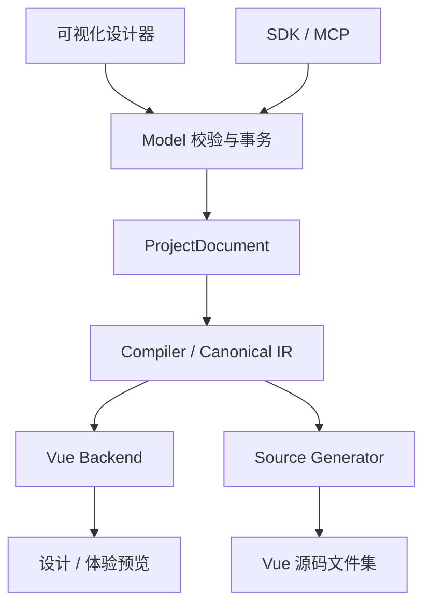

# 架构

## 设计文档与投影

`ProjectDocument` 是 Studio 的设计源文档，包含 Surface、Dataset、Resource、主题和
Registry 锁。所有正式设计修改通过 Model 命令与原子事务进入历史；面板展开、搜索、
未提交输入和体验实例状态不写回文档。

设计、体验与源码使用同一文档语义。Design 聚焦一个 Surface；Experience 运行页面历史、
浮层实例、参数和结果事务。预览采用隔离 iframe 与数据协议，源码在无 DOM 环境中生成。
源码文件不是设计模型的第二份可写状态。

## 当前分层

| 层 / 包                      | 责任                                                               |
| ---------------------------- | ------------------------------------------------------------------ |
| Core                         | JSON、值引用、reaction、Data Source 和布局等纯协议与服务           |
| Headless                     | Vue 字段模型、状态、校验、提交与 controller，不渲染 DOM            |
| Runtime                      | 组件解析、值绑定、布局、readonly 和宿主 Data 生命周期              |
| Runtime UI adapters          | Element Plus / Ant Design Vue 真实组件与绑定预设                   |
| Model                        | 项目、资产、引用、版本校验、事务、历史、Repository 和 transfer     |
| Compiler                     | 编译、能力诊断、Canonical IR 和增量缓存                            |
| Vue backend                  | 将 Canonical IR 投影为 Runtime 可执行配置                          |
| Designer / Designer adapters | 单 Surface 的结构、布局、属性、校验和受控交互编辑                  |
| Prototype Runtime            | 无 DOM 会话核心、实例隔离；独立 Vue 浮层 host                      |
| Source                       | 无 DOM 生成器、文件集与只读源码 Viewer                             |
| Studio SDK                   | 纯数据 preset、配置创作和源码生成；独立 HTTP Repository 客户端入口 |
| Local                        | 文件 Repository、HTTP/SSE、本地 CLI 与 MCP，托管构建后的设计器     |
| Workbench                    | 私有应用组合根，组合设计、项目管理、体验与源码交付                 |

生产依赖主链是 Core → Headless → Runtime → UI adapters。
Core、Headless、Runtime 不反向依赖 Designer、Workbench 或 Prototype Runtime。
Designer 不拥有项目仓库、生产副作用或源码宿主命令。

Source 不依赖 Designer、Workbench、具体 UI 组件或 Repository。宿主分别注入
provider component resolver、ConfigForm binding resolver 和 Resource reader；原生 Vue
生成不接收 binding resolver。Studio SDK 的生产入口不导入 SFC、CSS、Monaco 或 DOM。

## 视觉属性的本轮方案

通用视觉面板沿用节点 `props.style` 和现有属性命令，覆盖尺寸、间距、外观和排版。
`style` 和 `class` 作为通用呈现属性通过当前模型与编译校验，不要求每种物料重复声明。
多选、撤销重做、保存恢复使用已有事务，不增加另一份设计状态或 `node.design`。
非对象形式的 style，以及面板支持属性的 kebab-case 别名，保持受限只读，避免覆盖既有
表达或引入同一 CSS 属性的冲突写法；其他对象键在编辑时保留。

Compiler、Vue backend、Runtime 和两种源码模式必须保留相同的视觉值。源码生成的布局
样式作为默认值与用户 style 组合，并保留声明顺序，避免改变 CSS 简写与长写的优先级。
本轮不增加节点级断点样式；现有断点只表达已支持的表单布局。

## Inspector 的表单复用

每个 Inspector 只有一个 `DesignerPropertyForm` 模型和 renderer 实例。节点的普通属性、
通用视觉属性与校验字段，或表单级属性与响应式布局字段，都由 setter 和权威值投影成
Headless `defineField` 条目。尺寸、颜色等专用 setter 保留各自的交互，共用字段绑定与
本地编辑状态。

已有 `ConfigFormNode` 的 component nodes 与 slots 承载标签页、折叠分组和嵌入组件，
不增加新布局 DSL。字段条目完整地进入模型；搜索只筛选布局，标签页仅隐藏内容并保留
挂载，避免切换界面时清除草稿和错误。复杂的数据绑定、交互编辑器和校验实验室仍是
Vue 组件，不把这些界面或命令伪装成字段。

本地状态按属性路径标识字段，管理草稿、合法值解析、错误提示与命令后的权威值回灌。
提交一个字段不会清除其他字段的草稿；选区变化会重置草稿，每个条目执行独立的只读
限制并在权限变化时清理对应草稿。继承值仅用于显示，聚焦后直接离开控件不会把它
写成显式值。
多选条目保留每个节点的权威属性值和混合标志，避免把混合值误认为继承值；外部更新
这些值时清理对应草稿和错误。切换 Surface 也会清理草稿，即使节点 ID 与显示值相同。

表单 renderer 负责字段呈现与绑定；Designer 仍负责选区、多选修改、路径命令、事务和
历史。内存中的字段配置、组件和解析函数不进入 `ProjectDocument`。设计文档与 Runtime
执行配置继续分别表达设计意图和运行需求，本轮不新增 DSL，也不改变持久化合同。

断点启用是创建或删除覆盖配置的命令，直接使用开关控件；覆盖对象不映射为 boolean
字段。列数、跨度和标签宽度等可编辑值仍使用统一属性表单。画布与体验预览的 ConfigForm 渲染
实际 UI，校验实验室的 Headless controller 执行实际规则，这些使用场景保留。

## 保存与并发

浏览器模式使用 IndexedDB；文件工作区通过 Local 服务使用文件 Repository。
一个工作区只有一个权威仓库，不双写，也不在连接失败时静默切换到另一存储。

AI 与可视化编辑共用事务、revision、CAS 和幂等提交规则。文件服务协调写入，SSE 通知
客户端变化；有未保存编辑时保留草稿并提示冲突。预览、源码产物和导出绑定明确 revision，
生成后保留不可变 artifact，不能读取新配置却交付旧源码。

## 生成约束

- 相同文档与选项产生相同文件，不写随机 ID 或生成时间；失败返回可定位诊断。
- 嵌入资源按 metadata 与内容分离，缺失内容不能生成缺图工程；URL 资源不由生成器下载。
- 默认原生工程的运行依赖与裸包 import 只允许 Vue、Vue Router 和目标 UI 库。
  Vite、TypeScript 等构建工具属于 `devDependencies`。
- 原生工程不依赖 ConfigForm、Zod、`@moluoxixi/*`、`@config-form/*`，不复制解释器或
  Prototype Runtime。Required 与 RuleSet 生成可读的工程内代码。
- ConfigForm 绑定产物使用公开包，是另一种明确产物。两种模式独立生成和失败。
- 生成器不产生业务函数桩、HTTP 占位、字符串 action ref 或待绑定事件元数据。

生产 Runtime 的 `props.onX` 宿主函数只存在于内存配置，不进入设计文档、IR、
Preview transport 或源码生成。Dataset 查询由共享服务负责，物料不复制查询实现。

## 当前版本

| 合同                                            | 当前版本  |
| ----------------------------------------------- | --------- |
| ProjectDocument                                 | 8         |
| SurfaceGraph / Registry snapshot                | 3 / 3     |
| ProjectTheme                                    | 1         |
| Project / Surface / Dataset / Resource transfer | 1         |
| Canonical IR / Compiler                         | 7 / 8.0.0 |
| RuleSet                                         | 2         |
| Prototype session / Safe Expression             | 1 / 1     |

Reader 只接受精确当前合同，旧、未来、缺失或混合版本均拒绝。改变持久化结构时必须同时
审查 Reader、Writer、编译、预览、生成与测试，不增加双读或历史合同适配层。
本轮不升模型版本；未来源码导入本轮只记录 [边界提案](./source-import.md)，不添加来源或
能力字段。未来实施时再设计和版本化相关合同，并同步调整读取、保存、预览与生成链路。
